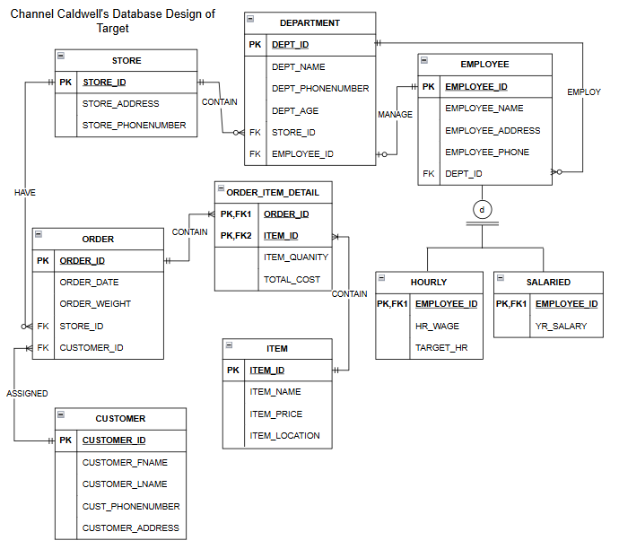

# Target Retail Database — (ERD)

## Project Overview
Designed an Entity Relationship Diagram (ERD) to model key parts of Target's retail operations, including stores, departments, employees, customers, orders, and inventory. The diagram shows how information is organized and how entities relate to one another in a retail database.

## Features
- Models stores and their departments, including department staffing and management.
- Distinguishes hourly and salaried employees and their respective pay information.
- Connects customers and stores to orders.
- Uses an Order Item Detail entity to resolve the many-to-many relationship between orders and items, recording quantities and total costs.
- Defines entity attributes and relationship cardinalities to represent the business rules.

## Skills Demonstrated
Database Design · ERD · Data Modeling

## ERD Screenshot

